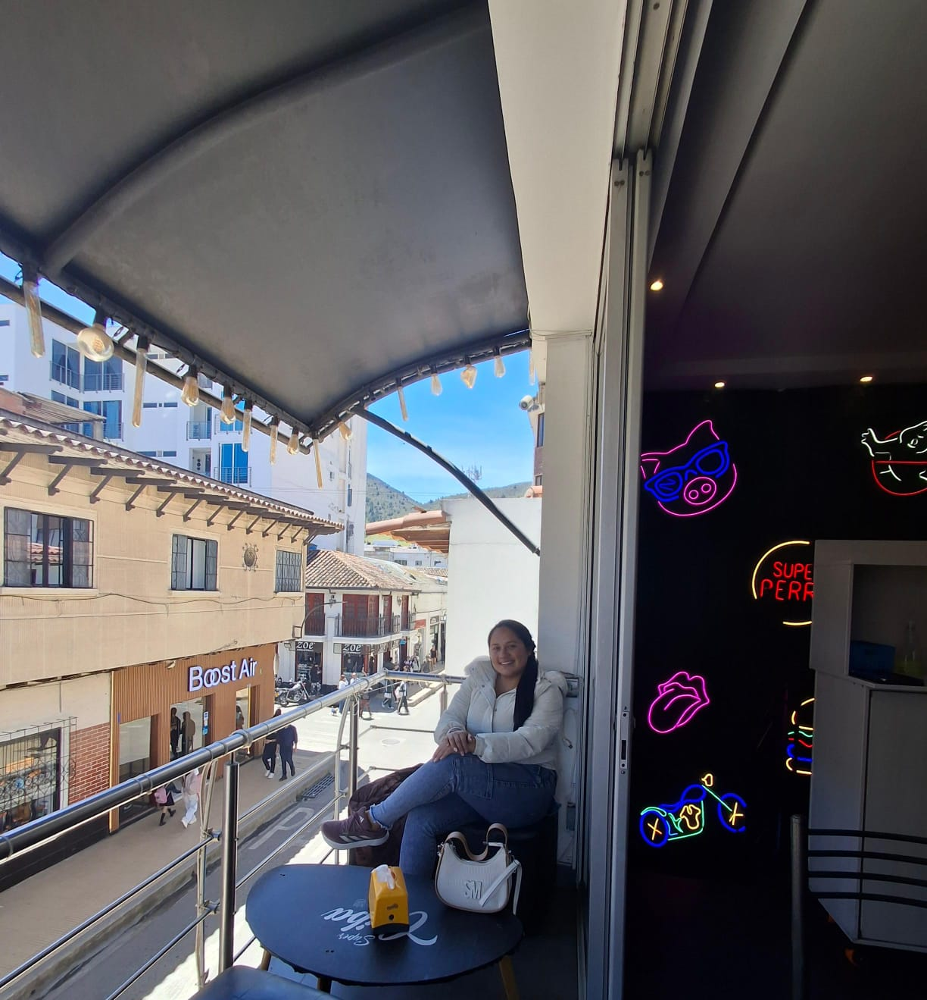
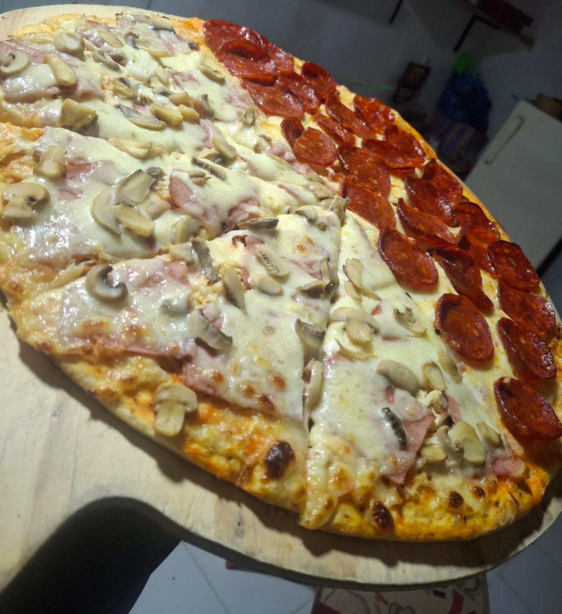

# Mi Perfil Personal

¡Hola! 👋 Mi nombre es *Mahir Daniela Duarte Suárez*.

## 📝 Descripción Personal
Tengo *23 años* y soy estudiante del programa de *Ingeniería Multimedia, originaria de **Chitagá, Norte de Santander* y perteneciente al *CEAD de Pamplona. Actualmente me encuentro cursando la materia de videojuegos. En mis tiempos libres me gusta mucho **leer, hacer deporte y aprender cosas nuevas* cada día.

---

## 📸 Mis Fotos

<p align="center">
  
  
</p>

<p align="center">
  <em>Izquierda: Mi Foto Personal | Derecha: Mi Plato Favorito</em>
</p>

# 🌿 GreenUp

GreenUp es un minijuego educativo 2D desarrollado en Unity para promover hábitos sostenibles en niños y adolescentes de 8 a 14 años.

## 🎯 Propósito

El jugador debe recuperar un barrio afectado por residuos, fugas de agua y pérdida de vegetación. Las acciones correctas transforman progresivamente el escenario y aumentan el indicador de sostenibilidad.

## 🎮 Mecánicas principales

- Movimiento lateral.🏃‍♂️
- Salto. ⬆️
- Recolección y clasificación de residuos.♻️
- Reparación secuencial de fugas de agua.🔧
- Selección y plantación de árboles.🌱
- Sistema de energía.⚡
- Indicador de sostenibilidad. 📊
- Retroalimentación visual y sonora.🔔

## ⌨️ Controles

| Acción | Tecla |
|---|---|
| Moverse a la izquierda | A o flecha izquierda |
| Moverse a la derecha | D o flecha derecha |
| Saltar | Barra espaciadora |
| Recoger o interactuar | E |

## 🏁 Objetivo

Completar correctamente las acciones ambientales hasta alcanzar el 100 % de sostenibilidad.

## 🏆 Victoria y derrota

El nivel se completa al alcanzar el 100 % de sostenibilidad. La partida se reinicia si los tres puntos de energía llegan a cero.

## ♿ Accesibilidad

- Contraste mínimo de 4.5:1 para textos del HUD.
- Iconos y números como complemento del color.
- Información crítica presentada de forma visual y sonora.
- Peligros diferenciados por color, forma y contorno.
- Textos breves y tipografía legible.
- Controles simples.

## 📂 Estructura recomendada

```text
Assets/
├── Animations/
├── Audio/
├── Materials/
├── Prefabs/
├── Scenes/
├── Scripts/
├── Sprites/
└── UI/
