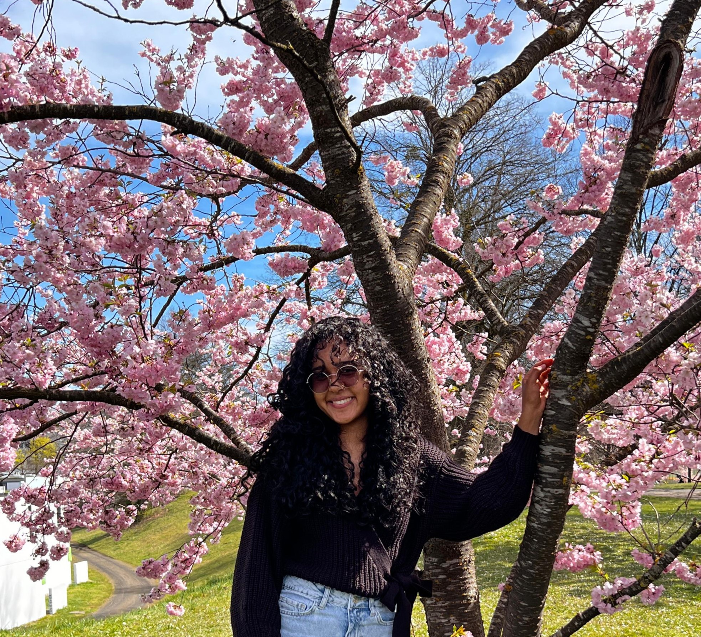
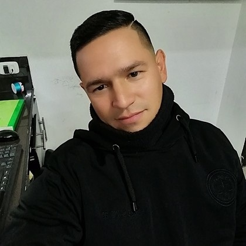

# Mi Perfil Personal

¡Hola! 👋 Mi nombre es *Mahir Daniela Duarte Suárez*.

## 📝 Descripción Personal
Tengo *23 años* y soy estudiante del programa de *Ingeniería Multimedia, originaria de **Chitagá, Norte de Santander* y perteneciente al *CEAD de Pamplona. Actualmente me encuentro cursando la materia de videojuegos. En mis tiempos libres me gusta mucho **leer, hacer deporte y aprender cosas nuevas* cada día.

---

## 📸 Mis Fotos

  
  

  <em>Izquierda: Mi Foto Personal | Derecha: Mi Plato Favorito</em>

# Andrea Bautista

**Rol:** Diseñador de niveles y Tester

**Ubicación:** Cúcuta, Colombia

## Perfil:
Soy estudiante de Ingeniería Multimedia. Me interesa todo lo relacionado con explorar
la creatividad y aprender sobre diferentes herramientas y tecnologías relacionadas
con el mundo multimedia. 
# Lionar Alexis Garcia Perez

* **Rol:** Diseñado Visual/ Audio 
* **Ubicación:** Pmplona 

## Perfil
Estudiante apasionado por el desarrollo y diseño de videojuegos. Me enfoco en crear experiencias interactivas atractivas, combinando creatividad en el diseño de niveles con lógica de programación eficiente. Siempre en búsqueda de aprender nuevas herramientas y metodologías de trabajo en equipo..
# Proyecto Videojuego 2026

Este repositorio contiene la entrega de la Fase 1 del curso de programación de videojuegos.  
Cada integrante creó su propia rama, agregó su carpeta personal con imagen de su plato favorito y editó su perfil en el README.  
La rama principal (main) reúne todas las contribuciones mediante merge, y la versión v1.0 marca la consolidación del trabajo inicial del equipo.

# Carlos Eduardo Serrano Gómez

**Rol:** Game Programmer

**Ubicación:** Colombia

## Perfil

Estudiante de Ingeniería Multimedia interesado en la programación, el desarrollo de videojuegos y la creación de experiencias digitales interactivas.

## Plato favorito

## GreenUp

GreenUp es un videojuego educativo 2D orientado a promover buenas prácticas ambientales mediante acciones como la clasificación de residuos, la reparación de fugas de agua y la plantación de árboles.

### Requisitos

- Unity 2022.3.58f1 LTS.
- Abrir el proyecto desde la carpeta `GreenUp`.

### Escena principal

La escena principal del proyecto se encuentra en:

`Assets/Scenes/GreenUpLevel01.unity`

### Controles

- `A / D` o flechas izquierda y derecha: movimiento horizontal.
- `Espacio`: salto.
- `E`: interacción con elementos ambientales.

### Mecánicas implementadas

- Movimiento y salto del personaje.
- Clasificación de residuos.
- Reparación de tubería en tres pasos.
- Plantación de árbol.
- Retroalimentación sonora de acierto y error.

### Ejecución

1. Abrir el proyecto GreenUp en Unity Hub.
2. Abrir la escena `GreenUpLevel01`.
3. Pulsar `Play` para iniciar la prueba del juego.
